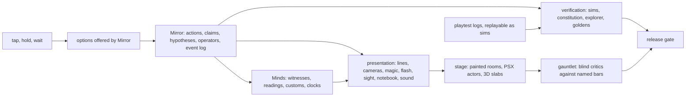

# Witch you were hear: the award plan

# My decision on the award plan

My recommendation is to accept the core strategy and most of the proposed upgrades, with a few important constraints before they enter the canon.

The biggest improvement is that the plan turns the game's central idea into experiences that cannot be replicated by dialogue alone. The Hold, the notebook that remembers earlier interpretations, the clockwork soundscape, and the camera that stays behind are all expressions of the same underlying design.  

Decisions D1–D8

Decision	Recommendation	Reason

D1 — English jury edition	Accept	Essential for international juries. Use a professional translator and English-language editorial review; preserve the original Russian voice and the title's pun.

D2 — Human collaborators	Accept	A native Russian editor, composer, real playtesters, and accessibility reviewer address weaknesses that automated tools cannot reliably judge.

D3 — Night of Returning	Accept with scope cap	Integrates replaceability, ritual, memory, and communal life. Keep it as a lived-in annual tradition, not a new quest system.

D4 — The Hold	Accept	The strongest proposed innovation. Touch becomes part of the story's meaning. Accessibility and emotional framing must be designed alongside it.

D5 — AI provenance policy	Accept	Protects visual coherence, licensing, transparency, and potential award eligibility.

D6 — Model routing	Accept	Useful production discipline, but it is not itself a creative differentiator. Human review remains essential.

D7 — Platforms	Accept with staged delivery	Web-first reduces jury friction, but real Android and iOS testing must start early, not after the game has effectively been designed for desktop.

D8 — Length	Accept	A 60–90-minute core experience, with an optional 5–15-minute postgame, suits the narrative's concentrated structure.

The plan proposes these decisions explicitly, while leaving them pending acceptance. 

Four upgrades I would protect above all others

1. The Hold — the signature mechanic

A finger physically holds Мирон in the room. The player can ask questions while holding; when the finger lifts, he returns through the threshold. There is no timer, and the world does not force a release. The player's input enacts the difference between keeping someone present and allowing them to leave. 

Constraint: never reward longer holding with a better outcome or make the player feel they must extract every possible answer. Include an accessible toggle, and ensure release is a meaningful action rather than a punishment.

2. The notebook as a palimpsest

Each entry opens the moment that produced it. Revised interpretations remain visible beneath the new reading instead of disappearing. The player can see the history of their own understanding.

This gives the thesis a physical interface: learning does not erase the earlier mistake; it changes how the player understands it. The pressed-flower stain is an especially strong persistent trace. 

Constraint: replay evidence, not the world itself. The notebook should remain an investigative workspace, never a disguised quest log.

3. Night of Returning

The yearly procession is a particularly good addition. Its script has been lost; families remember different versions, and the role is recast. The role can be replaced, but each year's performance is unique.

It gives the town its own mythology and makes the ending communal rather than exclusively private. The lanterns also provide another plausible reading of the final gold glow, preventing the event from proving that magic is responsible. 

Constraint: seed the festival through a poster, a conversation, and Shadow Mirror's notes. Do not build an elaborate festival simulation or explain its symbolism aloud.

4. The clockwork heartbeat and the final silence

Establish the town's clocks from the opening, let the music lose elements as the relationship changes, and stop every clock together for four seconds at the final threshold. The shop bell rings; the camera remains still; the world continues after she leaves.

The sound design makes absence perceivable. The missing musical line, the returning duet, and the final silence can communicate the relationship without explanatory dialogue. 

Constraint: commission a composer and test the scene on actual phones and headphones. Audio needs captions and redundant visual cues; silence must be meaningful without being inaccessible.

These four form a strong creative core because they reinforce one another without requiring four unrelated new systems. The Hold uses touch. The notebook preserves interpretation. The music gives relationship a temporal and sensory form. The procession makes the same ideas part of a living culture.

I would build and test these before adding lower-priority ideas.

Two more upgrades worth keeping

WAIT lets the town go on. Adopt the idea that explicit waiting advances the town's routines and allows other people to act. But reconcile it with the rule that the game has no time pressure. Fictional time can advance as a consequence of the player's choice without creating a real-time countdown or a hidden deadline that permanently destroys critical content.

Her coinages become customs. Keep this concept. When the witch invents a word and another mind independently adopts its meaning, it can become part of the town's shared culture. This is a beautiful example of the world retaining something the protagonist created without making her its permanent owner. The plan already restricts the number of coinages and requires agreement between minds before a custom emerges. 

I would use only a handful of genuinely memorable coinages in the initial release, not treat the maximum budget as a target.

20\. The three issues I would resolve before production

A. The window scene must not accidentally prove the wrong thesis

The plan says that Мирон leaves only when the witch looks away. The kettle also behaves according to a rule involving observation. Together, they create a brilliant transition from a comic physical puzzle to a relational one. 

However, this needs an explicit narrative decision.

Is the window scene a literal supernatural rule, a subjective misreading of events, or an intentionally unresolved observation?

My recommendation is to preserve the apparent pattern while avoiding a definitive causal claim. The player should be able to infer that looking away and leaving are related, then discover that a correlation does not establish motive or mechanism. Otherwise, the scene risks making Miron's independent choice into a magical law, undermining the distinction that the entire story is designed to preserve.

B. Fictional time must not become punishment

The plan simultaneously rejects time pressure and proposes that waiting advances other characters' routines. These can coexist, but the implementation contract needs to say how.

No passive countdowns. No hidden deadline while the player experiments. No irreversible loss of the main story because someone waited too long. Waiting should have legible consequences, while alternate evidence and a reliable hint ladder keep the game recoverable.

This preserves what is interesting about waiting—epistemic gain at the cost of initiative—without making curiosity dangerous in an unintended way.

C. Do not turn the award target into a feature-count target

The plan contains eighteen upgrades, thirteen scorecard rubrics, numerous verifiers, signature moments, platform work, and content-production pipelines. This is useful as a menu of possibilities, but the game must not become a checklist of award bait.

I would rank production work by whether it strengthens the core experience, not by how many rubric boxes it fills.

A useful release hierarchy is:

1\. The whole narrative works from beginning to end.

2\. The signature mechanics and ending work for real players.

3\. Every required room and character meets the agreed craft standard.

4\. Sound, accessibility, device performance, translation, and licensing are release-ready.

5\. Additional upgrades are accepted only when they materially improve the experience without compromising scope.

The proposed “11 out of 10” rubric is a useful aspiration, but repeated blind comparisons against named games cannot prove award readiness by themselves. Keep the independent panel, real playtests, and falsifiable tests. Treat the scores as evidence to discuss rather than as objective proof that a game is superior to a classic. The plan itself correctly acknowledges that awards cannot be guaranteed.  

Final recommendation

Accept the plan as a production strategy, with the Hold, the palimpsest notebook, Night of Returning, and the soundscape as the protected signature package. Accept the human-review, accessibility, provenance, and platform commitments as essential craft work—not optional polish.

Defer the remaining upgrades unless the vertical slice demonstrates that they materially improve the player experience. Resolve the window scene's causal status and the distinction between fictional time and time pressure before freezing the relevant contracts.

The award plan's most important insight is that Witch you were hear should not try to win awards by being exceptionally good at thirteen unrelated things. It should be technically and artistically excellent at everything necessary, while being unmistakably itself in a few experiences that only this game could create.

Those experiences are already visible in the proposals: holding someone present with a finger, seeing a former interpretation remain crossed out in a notebook, hearing a relationship change through music, and watching the camera stay behind when the witch chooses to go.

That is the direction I would commit to.

## 0. The bet

- **Be the best game in the world at one thing nobody else does:** what you believe about people is the playable
  material. The witch's notebook types every belief (seen, heard, shown, thought, expected, remade, not yet testable),
  every person in town models her back, and the climax is a rescue that works and still cannot prove what she needs it
  to prove. The bible names the genre; we should own the name: the **relational Metroidbrainia**.
- **Be flawless at everything else.** Juries forgive a small game. They do not forgive friction, confusion that was not
  designed, dead time, or a first ten minutes that does not land.
- **Make five moments people retell:** the kettle that boils only when nobody watches; the window, where he leaves only
  when she looks away; **the Hold**, where Мирон stays in the room for exactly as long as the player's finger stays
  down; every clock in town stopping on the same second; the camera that stays when she goes.
- **Close the gaps that cost awards today:** sound (a handful of synthesized effects exist; no score, no ambience),
  mobile builds (only Windows and Web export presets exist), one authorial voice across four parallel writers, the
  provenance of generated art, and real playtests.
- **Prove quality the way we already prove correctness.** Every rubric gets a named bar to beat, a blind critic panel
  and an executable verifier, using the three methods already in use: full-plan delivery, the gauntlet loop and the
  AAA v7.1 constitution.

## 1. What "11 out of 10" means here

No plan can promise an award: juries, timing and visibility decide. What we control is quality, eligibility and reach,
so "11 out of 10" is defined so that it can be checked.

- **10 on a rubric:** the game meets the best current practice on that rubric. Its verifier passes (a test, a
  measurement or a playtest threshold) and a blind critic panel scores it 9.5 or more on average.
- **11 on a rubric:** the game also **beats a named best-in-class work** on that rubric in blind pairwise comparison
  (three independent critics, ours preferred by at least two of three, in three consecutive rounds), and it does
  something on that rubric the bar does not do (a documented innovation from section 7).
- A rubric that falls back after reaching 11 is red until it is fixed. The scorecard lives in `docs/qa/SCORECARD.md`
  (created in Phase 1) and is updated after every polish round.

## 2. First principles

### What juries reward

1. **A new idea** that lets the medium do something it could not do before.
2. **Unity:** the mechanics are the theme. There is no seam between what the player does and what the game means.
3. **Craft without friction:** no bugs, no unintended confusion, no dead time, a perfect first ten minutes.
4. **A moment** that players retell to a friend.
5. **Respect:** accessibility, an honest length, no manipulation, no grind.
6. **A voice:** one frame or one line identifies the game.
7. **Jury reality:** judges play many entries in limited time, often twenty to sixty minutes each. A complete short game
   is experienced whole; a build that runs in a browser removes friction; and they must understand the text.

### Our unfair advantages

- **Mirror** already treats knowledge as the engine's subject: a hash-linked event log; claims with provenance and
  status, including UNRESOLVED_BY_DESIGN, which the engine refuses to upgrade; hypotheses; operators (learned rules
  that transfer to new situations); deterministic replay.
- **Minds** gives the town a theory of mind without runtime AI: who witnessed what, what each person made of it, and
  customs that form only when two minds read something the same way.
- **A culture of proof:** a constitution with verifiers, deterministic sims, golden transcripts, save integrity and,
  from QA now, a soft-lock explorer. Few games can prove they have no soft-locks.
- **A canon of rare depth and restraint** (the bible), with a voice sheet and budgets for reserved phrases.
- **A theatrical identity:** bolted cameras, cuts, diegetic 3D slabs, no 2D interface.
- **Russian as an asset.** The Fog (Туман) will remind every Russian player of Kozlov and Norstein's «Ёжик в тумане»;
  a story about a wizard who learns that love cannot be compelled sits in the tradition of Shvarts's «Обыкновенное
  чудо»; the comic logic belongs with Uspensky and Oster. These are tone bars for critics, never sources: no quotes,
  no pastiche. International juries find the lineage fresh; Russian players feel at home at once.

### What we will not do

- No meters, scores or percentages about people (C11), and no achievements for "correct" social choices.
- No runtime AI in the game.
- No tutorial text, no quest log (the notebook is not a to-do list), no map markers.
- No 2D interface and no camera that follows.
- No moral verdicts, no lessons, no "good ending".
- No time pressure, no grind, no collectibles for their own sake.
- Nothing from the private tone archive: patterns only, checked before every merge.

## 3. Bird's-eye view

### Where we stand

The integrator's estimate on 2026-10-29. The critic panel replaces it in Phase 1.

| rubric | now | what stands between now and 11 |
|---|---|---|
| R1 vision and coherence | 6 | a strong canon, not yet proven in play |
| R2 innovation | 5 | the engine supports it; no player has felt it yet |
| R3 narrative | 3 | the script is being drafted by four writers |
| R4 game design | 4 | engine and tests are strong; the acts are in progress |
| R5 visual art | 4 | the hall and a handful of painted rooms; most places are stand-in stages |
| R6 audio | 1 | a handful of synthesized effects; no score, no ambience |
| R7 interaction and feel | 6 | tap equals click, diegetic slabs, a latency budget; no hold, no haptics |
| R8 accessibility | 4 | text size, reduced effects, subtitles; no caption coverage, no audit |
| R9 technical | 6 | deterministic and tested; never run on a phone |
| R10 humour and delight | 3 | designed into the spec; not written yet |
| R11 emotional impact | 2 | unproven |
| R12 original property | 6 | a distinct concept and cast; final looks pending |
| R13 mobile | 2 | no Android or iOS export yet |

## 4. The scorecard

For each rubric: the awards that judge it, what 10 means, what 11 means, the bar to beat, how it is verified and who
owns it. New verifiers (C21 to C32) are listed in section 9.

### R1 Vision and coherence
- **Judged by:** IGF Seumas McNally Grand Prize; BAFTA Best Game; The Game Awards, Best Independent Game.
- **10:** every act's puzzle embodies one of the bible's ten distinctions and one of its eight literacies; nothing breaks
  the bible's section 16.
- **11:** the theme is proven by play, not stated: at the end, the player's own notebook (their revisions, their stain,
  their wand) reads as the theme having happened to them.
- **Bar:** Outer Wilds (knowledge is the only progression); Celeste (the mechanic is the theme).
- **Verified by:** C29 (thesis coverage), C1 to C11, the retell test (section 9). **Owner:** the integrator, QA.

### R2 Innovation
- **Judged by:** IGF Nuovo Award; Apple Design Award, Innovation; the press's "most innovative" lists.
- **10:** typed beliefs that the game never upgrades without evidence; чуйка (Expectation-Sight) with false positives;
  no meters anywhere.
- **11:** the Hold; a notebook whose entries replay the moment they came from and keep their crossed-out earlier
  readings; a town that takes up her coined words as customs, only when two minds share them.
- **Bar:** Heaven's Vault, Return of the Obra Dinn, Her Story, Immortality.
- **Verified by:** a blind "have you seen this before?" panel briefed on the genre; playtesters' answers to "what was
  new to you?", coded. **Owner:** SYS, writers C and D, QA.

### R3 Narrative
- **Judged by:** IGF Excellence in Narrative; BAFTA Narrative; The Game Awards, Best Narrative.
- **10:** distinct voices; no line explains anyone's psychology; ambiguity preserved by construction (C3, C9, C10);
  every act lands its distinction.
- **11:** the reinterpretation lands. At least 60% of playtesters say, unprompted, some form of "I was looking right at
  it the whole time" in the postgame; at least 80% retell the three truths (he left, he chose, he cared) and none
  reduces them to one verdict.
- **Bar:** Kentucky Route Zero; What Remains of Edith Finch; Disco Elysium for voice; Outer Wilds for its ending.
- **Verified by:** the voice lint (C30), the one-pen editing pipeline (section 8), table reads, the retell test.
  **Owner:** writers A to D, the editor, QA.

### R4 Game design
- **Judged by:** BAFTA Game Design; IGF Excellence in Design; D.I.C.E. Outstanding Achievement in Game Design.
- **10:** no soft-locks (C18); every wrong attempt yields evidence (C22); every act transfers a rule learned earlier
  (the kettle rule to Мирон, asking first to Tomas, revising before repeating to the threshold); a hint ladder.
- **11:** the rescue that works and the garden that cannot be saved are logically airtight (sims prove that every route
  leaves him in the Fog: C8) and still feel fair (fewer than 10% of playtesters feel cheated).
- **Bar:** Return of the Obra Dinn; The Case of the Golden Idol; Baba Is You.
- **Verified by:** the explorer, sims, C21, playtests. **Owner:** writers, FW, QA.

### R5 Visual art and direction
- **Judged by:** IGF Excellence in Visual Art; BAFTA Artistic Achievement; The Game Awards, Best Art Direction; Apple
  Design Award, Visuals and Graphics.
- **10:** every room meets the plate contract and the bar's measured numbers (`docs/visual-gauntlet/BAR.md`: median
  luma 0.16, 99th percentile 0.63, saturation 0.58); one focal point per room; plates and actors share one PSX
  treatment.
- **11:** 90% or more of a blind line-up identify any frame as ours; the palette tells the story without desaturation
  (absence, never grey); the Garden Below is the only still room in the game.
- **Bar:** references 13 to 17 and 04 (`docs/art/references/`); Kentucky Route Zero; the staging of Grim Fandango;
  the layered depth of Norstein's multiplane films (for mood only).
- **Verified by:** the visual gauntlet with actors standing in the rooms, the BAR metrics, C32. **Owner:** ART, CHARS.

### R6 Audio
- **Judged by:** IGF Excellence in Audio; BAFTA Audio Achievement and Music; The Game Awards, Best Audio Design and
  Best Score and Music.
- **10:** an adaptive score driven by Mirror state; diegetic ambience in every place; one loudness target; every
  meaningful sound captioned.
- **11:** the town's clocks are its heartbeat from the first second and stop together in act IX, the loudest silence in
  the game; the main theme is a duet whose second line is missing below and is whole only while she holds him.
- **Bar:** Outer Wilds (diegetic music that combines); Journey (an adaptive score); Kentucky Route Zero (performed
  songs); Inside (sound design).
- **Verified by:** a deterministic state-to-stems test, an offline loudness check, caption coverage (C24) and a human
  listening panel (agents cannot judge sound reliably). **Owner:** AUDIO (new).

### R7 Interaction and feel
- **Judged by:** Apple Design Award, Interaction; The Game Awards, Best Mobile Game.
- **10:** one finger plays everything; tap equals click; no 2D interface; a commit under 16 ms at the 95th percentile;
  every tap acknowledged within 100 ms.
- **11:** input carries meaning: holding is holding on, and letting go is letting go (the Hold); haptics speak the
  raccoon's flashes.
- **Bar:** Florence; Monument Valley 2; Gorogoa.
- **Verified by:** the input and flow tests, the latency test, on-device checks. **Owner:** FW, SYS, MOBILE.

### R8 Accessibility and inclusion
- **Judged by:** The Game Awards, Innovation in Accessibility; Apple Design Award, Inclusivity.
- **10:** text size; reduced effects; captions on by default for every meaningful sound; no meaning carried by colour
  alone; no time pressure anywhere; safe for photosensitive players; a hold toggle; a readable Cyrillic font.
- **11:** a game with no 2D interface that is still navigable with a screen reader (the slabs' text mirrored to the
  platform's accessibility tree, if the engine's support allows it: verify for Godot 4.6), and playable one-handed or
  with switch-style input.
- **Bar:** the options of The Last of Us Part II; the assist philosophy of Celeste.
- **Verified by:** C23, C24, a settings test, an external accessibility review. **Owner:** A11Y (new).

### R9 Technical excellence
- **Judged by:** BAFTA Technical Achievement; it underpins every other rubric.
- **10:** 60 fps on a mid-range phone from 2019; at most 60k static triangles and 28 surfaces; a room loads within 2 s;
  saves are never lost; no crashes under fuzzing.
- **11:** provable determinism (any playtest log replays to the same chain head), a proof of no soft-locks for every
  act, and damaged saves recovered to their longest valid prefix.
- **Bar:** the platforms' certification standards.
- **Verified by:** the gate, the performance probe on devices, fuzzing, C14, C15, C17, C18. **Owner:** FW, MOBILE, QA.

### R10 Humour and delight
- **Judged by:** Apple Design Award, Delight and Fun; every jury's memory.
- **10:** every misfire is funny and informative; a laugh-bearing beat at least every two minutes on the golden path;
  no generic failure line anywhere (C22).
- **11:** comedy that is causal and personal: the house's absurd records of the player's own run (about objects, never
  people), and a coinage of hers that the town takes up.
- **Bar:** Untitled Goose Game (systemic comedy); The Secret of Monkey Island (comic logic); A Short Hike.
- **Verified by:** C22, C27, table reads, a laugh log in playtests. **Owner:** writers, the editor.

### R11 Emotional impact and meaning
- **Judged by:** BAFTA Game Beyond Entertainment; The Game Awards, Games for Impact; Games for Change.
- **10:** the ending moves people without telling them what to feel; the game never moralises (C2 and the voice rules).
- **11:** in post-play interviews, players describe, in their own words, a change in how they think about needing to be
  needed.
- **Bar:** Florence; Journey; Spiritfarer.
- **Verified by:** playtest interviews; the critic panel. **Owner:** the integrator, writers.

### R12 Original property and debut
- **Judged by:** BAFTA New Intellectual Property and Debut Game; The Game Awards, Best Debut Indie Game.
- **10:** a distinct world, cast and title, held together by the bible.
- **11:** players quote the cast (Гаврила's mock officialdom, Тень's three-word lines) and recognise every character
  from a black silhouette (90% or more).
- **Bar:** Night in the Woods; A Short Hike; the cast of Hollow Knight.
- **Verified by:** the silhouette test; what playtesters recall. **Owner:** CHARS, writers.

### R13 Mobile
- **Judged by:** The Game Awards, Best Mobile Game; the Apple Design Awards; store features.
- **10:** native Android and iOS builds; touch-perfect; battery use and heat within platform norms; fully offline; a
  small download.
- **11:** the phone is the best way to play: the Hold under a real finger, haptic flashes, short sessions with an exact
  resume.
- **Bar:** Monument Valley 2; Alto's Odyssey; Florence.
- **Verified by:** device tests; the stores' pre-launch reports. **Owner:** MOBILE (new).

## 5. The signature moments

The moments the trailer, the press and the players will carry. Each has a proof. Note the symmetry the game is built
on: in act V the only way on is to let go; in act IX the only way on is to go.

| id | act | the moment | why it matters | proof |
|---|---|---|---|---|
| M1 | prologue | The kettle boils only when nobody watches; a forced boil sprays Гаврила and the tea tastes of thunder. | The first laugh within a minute, and the game's first rule: looking has a cost. | C27 timing; the clip reads without sound. |
| M2 | I | From the window seat, Мирон lingers while she watches and leaves when she turns away. | A rule about a kettle becomes a rule about a person: the genre's turn. | act1 sim; her prediction is recorded («Жду»). |
| M3 | I | Гаврила's eyes: a flash with no caption, the Fog's edge seen through him. | Access without certainty, felt rather than told. | the flash presenter test; a haptic pulse. |
| M4 | III | The clock tower gets bored, then falls asleep, until she revises instead of repeating. | Comedy that teaches model revision. | the explorer: the loop ends only by revising or by waiting three loops. |
| M5 | III | The Garden Below: differences appear only if she remembers the original. | Memory and presence as a rule of perception. | `requires_claims` tests. |
| M6 | IV | The wand: four choices, none of them correct. | Commitment without an answer key. | four exclusive branches, each with a postgame trace. |
| M7 | V | **The Hold** (U1). | Success that cannot prove consent, enacted by the player's own finger. | C26; a device check. |
| M8 | V | Water turns to dust; a pressed flower leaves a stain on the notebook page for the rest of the game. | The anti-puzzle, and memory you can touch. | C5; the stain survives saves. |
| M9 | VI | The half-light: Гаврила's mediocre lamp, and he laughs. | The intimate offering, accepted. | act6 sim. |
| M10 | IX | Every clock stops on the same second; silence; the bell; «Привет.» … «Пойдём.»; she goes; the camera stays. | A decision without proof, and the payoff of a camera that never followed. | the ending tests; the silence test. |
| M11 | postgame | One knot on five objects, and the inference that he asked Тень to look after her. | Reinterpretation, the Metroidbrainia's real reward. | C10; the retell test. |

## 6. The experience map

Target minutes are for the golden path (about 77 minutes, inside X38's 60 to 90). Literacies and distinctions are the
bible's; mystery types follow the user's synthesis (solvable, social, interpretive, irreducible). The palette and sound
columns are proposals for ART and AUDIO.

| part | min | the feeling | literacy | distinction | mysteries | palette | sound |
|---|---|---|---|---|---|---|---|
| prologue | 9 | delight in her power | perceptual, causal | (sets the stage) | solvable | violet, blue and magenta masses; gold and red accents | the duet theme, whole; ticking clocks; the shop bell |
| I | 11 | the floor tilting | temporal: a prediction is not an explanation | desire and demand; visibility and understanding | social, interpretive | the same, cooler towards the Fog's edge | the theme loses an instrument each day |
| II | 14 | comic displacement | social | replacement and changed function; need and care; no universal rule (Вера) | solvable, social | misfire colours; the lamplighter's warm lamps | wrong notes in the theme; a fuller town without her |
| III | 10 | wonder with unease | semantic, spatial | memory and presence | solvable, interpretive | the Below narrows to her own colours | a music box plays her line alone |
| IV | 3 | the hinge | commitment | power and its guarantee | — | still | silence and one held note |
| V | 10 | understanding that hurts | epistemic | outcome and motive | irreducible | violet, held; then the garden's dust | his line alone beyond the glass; the duet whole only during the Hold; the music box winds down |
| VI | 8 | quiet relearning | relational | capability and reliability; access and certainty | social | the upper world's colours with fewer glints (absence, never grey) | sparse and acoustic; Гаврила hums |
| VII | 6 | joy | relational, with power | potential and permission | social | verdigris joins the palette | the theme re-harmonised with a third voice, not the old duet |
| VIII | 2 | grace | encounter | attention without obligation | — | ordinary gold | near silence, one sustained tone |
| IX | 4 | invitation | commitment under uncertainty | uncertainty and truth | irreducible | gold coming down the street | every clock stops; silence; the bell |
| postgame | 5–15 | archaeology | reinterpretation | memory and presence; the three truths | interpretive, irreducible | the lived-in house | the house's ambience; no theme until the doorframe |

## 7. Upgrades beyond the spec

None of these changes the frozen contracts of the current sweep. The integrator adds the contract changes to GAME_SPEC
between waves (section 10), so nobody builds against a moving target.

| id | upgrade | rubrics | owner | phase | contract change |
|---|---|---|---|---|---|
| U1 | The Hold (X42) | R2, R7, R11 | SYS, FW, C | 2 | hold start and end intents; `act5_hold` unchanged |
| U2 | The notebook as palimpsest, with openable evidence | R2, R3 | SYS | 2 | every entry carries the event that produced it |
| U3 | Motif echoes across acts | R3, R11 | SYS, writers | 2 | `motifs` tags on responses |
| U4 | The clockwork heartbeat, the great silence, the duet | R6, R11 | AUDIO, D | 2 | sound chosen by a pure function of Mirror state |
| U5 | The Night of Returning (X41) | R3, R5, R6, R11 | D, ART, AUDIO | 2 | act IX's beats |
| U6 | Her coinages become customs | R2, R10 | A, B, D, QA | 2 | Minds conventions carrying her words |
| U7 | Her memory as hints | R4, R8 | SYS, writers | 2 | a stuck detector; `hint.` text keys |
| U8 | Camera grammar: deadpan, ridiculous, reveal, memory | R5, R10 | FW, writers | 2 | new `camera.mode` values |
| U9 | Playtest flight recorder | R4, R9 | TOOLS | 1 | none: it reads the log |
| U10 | The PS1 pass for plates and actors | R5 | ART | 1 | none |
| U11 | Provenance and licence gate | R9, release | QA, ART | 1 | a provenance record for every shipped asset |
| U12 | Table reads from sims | R3, R10 | TOOLS | 1 | none |
| U13 | The house remembers every major choice | R1, R11 | D | 2 | reads published ids |
| U14 | Absurd records of the player's run | R10 | D, SYS | 3 | counts about objects only (C11) |
| U15 | A haptic language | R7, R8, R13 | SYS, MOBILE | 3 | a `haptic` presentation kind |
| U16 | Jury edition with English subtitles | awards | LOC | 4 | `data/text/en.json` and fragments with the same keys |
| U17 | WAIT lets the town go on | R1, R2 | FW | 2 | WAIT advances the Minds clock, under the event budget |
| U18 | Calibrated чуйка | R2, R3 | SYS, writers | 2 | expectation entries gain `revealed_by` |

### U1 The Hold (X42)
- At the threshold in act V, pulling Мирон through is a held input. **Touch:** a finger on him, kept there; he comes
  through and stands in the room while the finger stays down; a second finger asks one of three questions and he
  answers kindly and briefly; lifting the finger lets go, and he steps back through. **Mouse:** hold the button; ask
  with the keyboard accelerators 1 to 3, or use the toggle. **Toggle** (accessibility, and the default where holding
  is hard): one tap holds; any tap that is not a question lets go.
- No timer, ever. The screen stays awake. He never leaves while held. The world waits: the clocks tick, the duet holds.
- The only way forward is to let go.
- Mirror is unchanged (`act5_hold {"held": true}`, released by any other action). The input layer maps hold start and
  hold end to the existing actions, so sims drive them as ordinary actions.
- Verified by C26: a sim holds for ten thousand simulated seconds and asks every question, he stays, and any other
  action releases; an input test proves touch and mouse give the same chain; a device check.

### U2 and U18 The notebook as palimpsest; calibrated чуйка
- Every entry opens its moment: a tap replays the line and the shot from the event that produced it (the log is
  deterministic). A revision keeps the earlier reading visible, crossed out, under the new one («Переделала»).
  UNRESOLVED_BY_DESIGN entries stay questions. Different kinds of discovery surface in a mix, not ten of one kind.
- A ghost that turns out to be her own projection becomes a revision too. The player learns calibration without being
  told.
- Verified by: every displayed entry resolves to an event; a revision keeps its history.

### U4 The heartbeat, the silence and the duet
- The main theme is a **duet**: her line and his counter-line. The prologue plays both. In act I one instrument drops
  out each day. Below, a music box plays her line alone: the garden that is only hers, in sound. At the threshold his
  line is heard alone from beyond the glass; during the Hold the two lines play together for the only time since the
  prologue; when she lets go, his line recedes. In act VII the theme returns re-harmonised with a third voice: magic
  returns without restoring the old arrangement.
- Every place in town carries the ticking of its clocks at the act's tempo. In act IX every clock stops on the same
  second: four seconds of total silence (ambience included), then the shop bell. After she leaves and the camera
  stays, the clocks start again: the world goes on.
- The stems are chosen by a pure function of Mirror state (act, place, `magic.state`, the hold), so sims and replays
  reproduce the mix, and a test asserts the mapping and the silence.
- A human composer is strongly recommended (D2). Until one joins, the stems are placeholders built from the same
  motifs with open-licence instruments.

### U5 The Night of Returning (X41)
- From the user's own design synthesis: Тень's private passion is the town's yearly Night of Returning, a home-made
  Persephone play and a lantern procession whose script was lost, so every family remembers a different version and the
  role is recast every year. The role is replaceable; each year's performance is not.
- In the game, act IX's impossible event happens on that night. The gold glow coming down the street is also the
  procession's lanterns: a fourth, ordinary reading beside the Fog, Тень and her own magic, which keeps gold from
  proving magic. Тень arrives carrying absurd festival kit; «Привет.» … «Пойдём.»; the witch goes and joins the
  procession as one among many; the camera stays on the street as it moves away.
- Seeds, with no new systems: a poster without letters (a drawn lantern and a crown) in act II; townspeople arguing
  about last year's Hades in act VI; Тень's festival notes as a postgame object.
- Cost: one plate variant (the street at dusk with lanterns), crowd silhouettes as billboards, a diegetic band. It fits
  inside act IX's area and is reversible.

### U6 Her coinages become customs
- She coins words; the voice sheet already says so. Choose at most twelve for the whole game and register them in
  VOICES.md. A coinage enters the Minds layer as a reading and becomes a custom only when two minds read it the same
  way (the negative-emergence rule the engine already enforces): Гаврила uses one, grudgingly, in act VI; the town uses
  another in act VII. Never explained.
- Verified by a negative sim (only she uses the word: no custom forms) and a positive one.

### U7 Her memory as hints
- A stuck detector (no new claim or operator for N minutes in the act, N set by the hint level) makes her muse, in her
  own voice, about a notebook entry that matters for an action available now. Three rungs: notice, connect, try. Never
  an instruction, never the ontology, never an answer to an irreducible question. Settings: off, normal, eager.
- Verified by: every claim on an act's golden path has a hint chain; the voice lint covers `hint.` keys.

### The others
- **U3 Motif echoes.** Authored motif tags (the knot «с петлёй, как ухо», the comet, the sunflower, the bell, the key)
  on events. When a motif returns in another room and form, the notebook notes the rhyme; the postgame's inference
  reads the motifs.
- **U8 Camera grammar.** `deadpan` (the camera holds still and refuses to react after a misfire), `ridiculous` (a
  too-dramatic push-in on something trivial), `reveal`, and `memory` (for evidence replays). Comic timing is mostly
  editing, and these give writers the cuts.
- **U9 Flight recorder.** With the player's consent, the Mirror log and the presentation timings are exported and
  replayed as sims, then aggregated: where people got stuck, time per act, hints used. Every playtest becomes a
  replayable sim.
- **U10 The PS1 pass.** Generated plates come back smooth and clean (the spike's finding), so the crudeness has to be
  imposed: a deterministic local pass maps each plate to the act's palette with ordered dithering on the texel grid,
  posterises and crushes edges; actors take their light from the plate. Judged with actors in the room against the
  references.
- **U11 Provenance gate.** Every asset carries a record (tool, model, licence, prompt, seed, date, human edits).
  Shipped assets must be on an allow-list: our own work, CC0, CC-BY (credited), OFL fonts, and models whose licence
  and outputs allow distribution. Never shipped: anything from a non-commercial or research-licence model, the
  third-party captures (references 11 and 12), or the unconfirmed `pixel.ttf` (replace it with an OFL Cyrillic pixel
  font).
- **U12 Table reads.** `tools/qa/table_read.py` prints each act's sim as a screenplay (speaker, line, stage directions
  from the presentation steps) into `build/` (git-ignored) for the editor and the critics.
- **U13 The house remembers.** Every major choice leaves a physical trace in the postgame: the wand by its branch;
  Tomas's spare cam as a bookend if he finished his machine himself; Элиан's cup on the shelf if he came to say «ты»;
  Илья's backwards clock if it was left unfixed; the half-lamp in the kitchen; the stain in the notebook; Тень's
  objects; «Ведь мы были здесь» on the doorframe.
- **U14 Absurd records.** In the caption register, counts about objects only, drawn from the player's own log: the
  kettle was looked at fourteen times and no longer takes it personally. Never about a person (C11).
- **U15 Haptics.** A soft double pulse for a flash, a faint heartbeat during the Hold, a short pattern per magic mode,
  and an off switch.
- **U16 Jury edition.** An English text table with the same keys, for juries and press; the title and its pun kept; a
  translator's note in the press kit.
- **U17 WAIT lets the town go on.** Today WAIT does not run Minds routines (X34). Let it advance the Minds clock so
  people move while she waits; plot-critical sequences stay Mirror state machines; the event budget (C17) holds.

## 8. Craft plans by discipline

### Writing: one pen
1. Draft: writers A to D (in flight), with the lore analysts' patterns (word formation, running-gag structures,
   relational textures; never a quote).
2. Table read (U12).
3. **One editor-in-chief for the whole game**, on the strongest model available: one voice per character across the
   four writers, the reserved-phrase budgets, and a cut of about a fifth of the lines. Economy is a jury signal.
4. Blind critics against the tone bars (Kozlov's hedgehog tales for gentle melancholy, Shvarts for wit about love and
   power, Oster for comic logic), judging rhythm, wit and restraint, never resemblance. Loop until ours wins.
5. Native human editors: at least two readers, one of them a professional (D2).
6. The voice lint (C30) and the privacy guard before every merge.
7. Playtest laugh and confusion logs, then revise.

Running gags are planned, not found: six to ten callbacks with a seed act and a return act (the knot, Гаврила's
one-word verdicts, the kettle, the bored clock, the commission board, and the telepathy gag from the synthesis, in which
he sends three images that tell her nothing, separately, and each blames the other's reception).

### Art
- **Order:** the opening's rooms (shop, window, garden, street) to final quality first, because they are the jury
  window; then the rooms of the signature moments (the Below, the threshold, the clock tower); then the rest. The free
  quota (eight runs a day) sets the pace.
- **Room checklist** for the gauntlet: one dominant question; one focal point; five to seven depth layers; one
  beautiful, ridiculous, moving, reactive, unexplained and possibly meaningful thing with negative space around it; no
  letters; a walkable floor; arrival spots; ambient life everywhere except the Below.
- **AI provenance (D5):** generated plates are layout and previsualisation. The shipped plate is rebuilt in the Blender
  kit (authored and procedural), or finished by a human artist, and its provenance is kept (section 11 says why).
- **The palette arc** of section 6, with absence, never grey, in the magicless acts.

### Characters and animation
- CHARS (in flight): the witch's look (X23) and the crude NPCs. Next: the signature animations (the bench leaning back,
  the kettle sulking, the clock yawning and falling asleep, Гаврила sprayed with tea, the Hold, the wave at the glass,
  Тень's beckon); gaze for every NPC; the raccoon's ordinary wooden wand and magician's hat as a postgame trace (from
  the user's synthesis); the silhouette test.

### Audio: the sound bible
- **The clocks:** the town's heartbeat, with a tempo per act. **The shop bell:** arrivals; in act IX it rings for
  nobody. **The Fog:** sound with its differences removed (high frequencies rolled off, intervals collapsing to unison).
  **The Below:** dry, no reverb tail, the music box. **Magic:** violet bright and plucked; verdigris breath and open
  fifths; gold one sustained tone. **Гаврила's attic:** ticks, solder hiss, muttering. **The procession band** if X41.
- **Voices:** no voice acting (X27: lines are read). Optional speech blips built from each line's syllables, with a
  pitch and rhythm per character, subtle, with an off switch; test them with players before committing.
- **Mix:** a loudness target suited to phones (around -16 LUFS integrated is common for mobile; verify per platform);
  lines duck the music; every meaningful sound captioned (C24).
- **Tools:** `tools/painted/synth.py` for effects; open-licence instruments with provenance; a composer for the score
  (D2).

### Interaction and UX
- No tutorial text: the prologue's toys teach looking, casting, waiting, asking and showing.
- At most four options on a plaque, in natural Russian; the ontology never shown (invariant 1).
- Every tap answered within 100 ms by a small diegetic reaction, even before Mirror commits.
- An autosave after every action and an exact resume (the log replays).
- Every game rule is discoverable through two independent signals (a picture and a sound, or a picture and a line).

### Accessibility
- Settings stay diegetic (`game/ui/settings_menu_ui.gd`): text size, reduced effects (the PSX wobble and the CRT pass),
  captions (on by default), hint level, the hold toggle, haptics, speech blips, high-contrast slabs, a
  dyslexia-friendly font if one covers Cyrillic well.
- Magic is legible without colour: violet spirals outward, verdigris laces through, gold holds still.
- No flash faster than three per second (C23); no time pressure anywhere; one-handed play; a screen-reader mirror of
  the slabs if the engine allows it.

### Engineering and performance
- MOBILE (Phase 1): Android and iOS export presets; a device lab of at least one low-end Android phone and one older
  iPhone; on-device frame time, memory, heat, battery and load times; a Web build for juries (size and load time).
- The gate stays green; a nightly whole-game sim; CI on every push; golden renders.

## 9. Verification

### Constitution additions (proposed)

Each joins `architecture/constitution.json` as pending with its verifier, and turns verified when the test exists and
passes.

| id | must hold | verifier (proposed) | class |
|---|---|---|---|
| C21 | Every act lets the player see a prediction fail and revise a model on its golden path. | `tests/design/test_experience.gd::test_every_act_revises_a_model` | hard |
| C22 | Every available action on every target has an authored, target-specific response; there is no global "nothing happens". | `tests/design/test_constitution_content.gd::test_every_failure_is_explained_by_the_world` | hard |
| C23 | No presentation flashes the screen more than three times a second. | `tests/presentation/test_photosafe.gd::test_no_flash_exceeds_three_hertz` | hard |
| C24 | Every meaningful sound has a caption key, and every colour-coded meaning has a shape or motion channel too. | `tests/a11y/test_redundant_channels.gd::test_every_signal_has_a_second_channel` | hard |
| C25 | Every shipped asset has a provenance record with an allow-listed licence. | `tests/release/test_provenance.gd::test_every_shipped_asset_is_licensed` | hard |
| C26 | While held, Мирон stays for any length of time; any other action releases him; no timer exists. | `tests/content/test_act5_hold.gd::test_the_hold_lasts_as_long_as_the_player_holds` | hard |
| C27 | On the golden path the first laugh-bearing beat commits within 60 s of control, the first notebook entry within 3 min and the first inference within 8 min. | `tests/design/test_first_minutes.gd::test_the_opening_lands_on_time` | recoverable |
| C28 | The golden path's estimated time (presentation durations plus reading time) is between 60 and 95 minutes. | `tests/design/test_session_length.gd::test_the_golden_path_fits_the_session` | recoverable |
| C29 | All ten of the bible's distinctions and all eight literacies are declared by some area, in the bible's order. | `tests/design/test_thesis_coverage.gd::test_every_distinction_is_played` | hard |
| C30 | The voice rules and the reserved-phrase budgets hold. | `tests/content/test_voice_rules.gd` (QA, in flight) | hard |
| C31 | No player-visible line shares a run of six or more words with the private tone archive. | `review://privacy-guard` (run outside the repository before every merge) | review |
| C32 | The Garden Below is the only room without ambient life while it is alive; every other room has some. | `tests/world/test_room_life.gd::test_only_the_below_is_still` | soft |

### The critic panel
- Personas, each a separate run that never sees which side is ours: a festival juror who plays the first thirty minutes
  cold, a narrative designer, a Russian editor, an art director, an accessibility auditor, a mobile UX lead and a
  comedy writer.
- Material: blind pairs of text excerpts, frames with actors in rooms, and interactions described from sims. Each
  critic scores the rubric from 1 to 10 with reasons. The loop continues until ours wins (the gauntlet).
- Limits: agents can judge text and pictures. Sound, feel and native nuance need people.

### Playtests
- **P1** (Phase 1): five native Russian speakers, the first twenty minutes. **P2** (Phase 2): eight to ten players,
  the whole game. **P3** (Phase 3): fifteen or more, including non-gamers, older players and players with access
  needs. **Jury simulations:** experienced players play thirty minutes cold.
- **Instruments:** the flight recorder (U9), think-aloud, and an interview: retell the story; the three truths; the
  moment you remember; a line you remember; where you were confused; one sentence to a friend.
- **Thresholds:** a first smile within 60 s for 80% of players; nobody stuck for more than five minutes without a hint
  on offer; 80% completion; 80% retell the three truths; 60% have the "I was looking right at it" moment; 10% or fewer
  feel cheated; a median session of 60 to 95 minutes.

## 10. Production

### Phases

| phase | aim | main work | exit gate |
|---|---|---|---|
| P0 Build the whole game (now) | GAME_SPEC's definition of done | FW, SYS, A to D, ART, CHARS, QA and the lore analysts (waves 1 and 2) | playable end to end on stand-in stages; C1 to C20 verified; the whole-game sim; the gate |
| P1 The jury window | the first twenty minutes at 11 | the opening's rooms final (with the PS1 pass); the witch, the raccoon and Мирон final; prologue and act I through the one pen; audio v1; captions and settings; the Android build; U9, U11, U12 | the panel prefers ours to the bars in three of three on the opening; P1 thresholds; 60 fps on the device lab |
| P2 Signature moments, content complete | every moment of section 5 at quality | U1 to U8, U13, U17, U18; all plates; all characters; audio v2 (adaptive score, the silence) | C21 to C32 green; P2 thresholds |
| P3 Polish by rubric | 10 everywhere, and 11 on at least R2, R3, R4, R6 and R7 | gauntlet loops per rubric; native editors; the composer's score; an accessibility audit; device performance; no known bug above minor | the scorecard; P3 thresholds |
| P4 Release and awards | eligibility and reach | builds, store pages, the trailer, the press kit, the jury edition, submissions | submitted on time; the press kit live |

Durations are estimates and depend on the decisions in section 13 and on the people they bring in: P1 one to two weeks
(bound by the art quota), P2 two to four weeks, P3 three to six weeks (bound by editors, the composer and playtesters),
P4 about two weeks, timed to the submission windows.

### Waves and workcells
- **Wave 3 (P1):** EDIT-1 (prologue and act I, one pen), ART-1 (the opening's rooms, the PS1 pass), CHARS-2 (final
  looks and the opening's signature animations), AUDIO-1, A11Y-1, MOBILE-1, TOOLS (U9, U11, U12).
- **Wave 4 (P2):** SYS-2 (U1's presenter, U2, U7, U18), FW-2 (U1's input, U8, U17), C-2 (the Hold's content), D-2 (U5,
  U13), A, B and D for U6, AUDIO-2 (the adaptive score and the silence), ART-2 (the Below, the threshold, the clock
  tower, the hotel, the attic, the basement, the street at dusk), QA-2 (C21 to C32).
- **Wave 5 (P3):** one gauntlet cell per rubric, EDIT-2 (the whole game), external playtests, LOC if D1.
- The rules stay as they are now: one tracker (beads), frozen contracts per wave (the integrator changes GAME_SPEC's
  contracts only between waves), disjoint write sets, and the integrator merges after the privacy guard and the gate.

### Model routing (D6)
Builders run on the fast model at maximum reasoning, as now. The editor-in-chief and the critic panel run on the
strongest model available. People do what agents cannot judge: sound, feel, native nuance, playtests.

### Cadence
Merge on every report (merge, text check, privacy guard, gate, push); a nightly whole-game sim; the scorecard after
every polish round; one beads epic per phase.

### Award-ready means
- every rubric at 10 or more, and at least five at 11;
- C1 to C32 verified; no known bug above minor; no crash under fuzzing;
- the jury window has passed three blind panels and P3;
- the Web, Android and iOS builds run at 60 fps on the device lab;
- every shipped asset carries an allow-listed licence, and AI use is disclosed wherever the rules ask;
- the press kit, the trailer and (with D1) the jury edition are ready.

## 11. Release and awards

- **Platforms:** Web first (a juror can play in a browser within seconds), then Android, iOS and Windows (Steam). The
  bible says mobile-first, and the phone should be the best version (R13).
- **The jury edition (D1):** English subtitles only, with the same keys; the title and its pun kept; for juries and
  press.
- **AI policy (D5):** rules differ by event and keep changing, and in December 2025 at least one indie awards show
  withdrew awards from a celebrated game because generative-AI placeholder textures had shipped in it. Read each
  event's rules before entering; disclose AI assistance where it is required (Steam's content survey asks); ship
  authored or human-finished art (section 8); keep provenance for everything (U11).
- **The calendar** (typical windows; check each one before planning around it): IGF (entries usually close in early
  autumn for the festival in March; it has accepted unreleased games), A MAZE in Berlin (an open call in winter, the
  festival in spring), Games for Change (summer), BAFTA Games Awards (entries in late autumn and winter for games
  released that year; the ceremony in spring), The Game Awards (December; no entry, a media jury, so visibility
  matters), the Apple Design Awards (June; no entry, Apple's editors find apps on the App Store), and curated showcases
  such as Day of the Devs and Tribeca Games. The realistic order: festivals that take unreleased games first, release
  when P3 is met, then the awards of the release year.
- **The trailer, in sixty seconds:** black, ticking; the shop bell; «Смотри!» (subtitled "Watch this."); the kettle;
  the bench leaning back, laughing; the window; a lamp that lights and politely goes out; the clock falling asleep; the
  Below, too still; the glass, her hand, the Hold, a finger on the screen; dust; every clock stops; silence; the bell;
  «Привет.» … «Пойдём.»; she goes, the camera stays; the title.
- **The press angles:** the rescue that works; a game with a constitution of tested invariants; no meters; every clock
  stops; Russian-language, with English subtitles for press.
- **The store page:** moments M1, M2, M7 and M10 (never the postgame); a short clip of the kettle.

## 12. Risks

| risk | likelihood | impact | mitigation |
|---|---|---|---|
| Four parallel writers do not add up to one voice | high | high | one pen (an editor-in-chief), the voice lint, native editors |
| Generated plates read smooth and clean, and clash with the crude actors | high | high | the PS1 pass, the gauntlet with actors in rooms, Blender rebuilds |
| Generative-AI provenance blocks eligibility or sours reception | medium | very high | D5; provenance records; disclosure |
| There is no sound | certain today | high | AUDIO in P1; a composer (D2) |
| Phone performance is unknown | medium | high | MOBILE in P1; the device lab |
| Russian-only text limits international juries | high | high | the jury edition (D1) |
| Players miss subtle rules (the kettle, the window) | medium | high | two signals per rule, hints (U7), playtests |
| A line collapses the ambiguity (confirms a motive) | medium | high | C3, C9 and C10; the editor's check |
| Scope grows (the festival, perceptual spells, more dilemmas from the syntheses) | medium | medium | adopt only X41 now; defer the rest to a later version |
| The free quotas (eight plates a day) and a four-core build machine slow production | high | medium | the priority order; waves sized to the machine; one gate per merge |
| The private archive leaks into the game | low | very high | patterns only; the guard before every merge; nothing from it in the repository |
| Agent rate limits stop a wave | medium | medium | small slices committed early; progress files; resumable briefs |
| The pixel font's licence is unknown | certain | medium | replace it with an OFL Cyrillic pixel font |
| Some read the title as a typo | medium | low | the in-world echo and the press copy carry the pun; keep the title (X22) |

## 13. Decisions for you

| id | decision | recommendation |
|---|---|---|
| D1 | An English jury edition | Yes: subtitles only, for juries and press. |
| D2 | People: a native Russian editor, a composer, 15 to 30 playtesters, an accessibility reviewer | Yes. The editor is essential and the composer strongly recommended; agents cannot stand in for them. |
| D3 | X41, the Night of Returning in act IX | Adopt. |
| D4 | X42, the Hold as a literal hold | Adopt. |
| D5 | The AI provenance policy | Generated pictures as layout only; shipped art authored in Blender or finished by a person; disclose where the rules ask. |
| D6 | Model routing | The fast model for builders, the strongest for the editor and the critics. |
| D7 | Platforms | Web first, then Android, iOS and Windows. |
| D8 | Length | Keep 60 to 90 minutes (X38). |

## 14. The next 48 hours

1. Merge waves 1 and 2 as their reports land (FW and SYS first): text check, privacy guard, gate, push. Move the sims
   from `data/sim_pending/` into `data/sim/` as their chains complete, and mark verified the invariants QA reports
   ready.
2. Send the writers the lore briefs as soon as the analysts finish.
3. Once D1 to D8 are answered, write the wave-3 briefs (EDIT-1, ART-1, CHARS-2, AUDIO-1, A11Y-1, MOBILE-1, TOOLS) and
   add X41, X42 and the new contracts to GAME_SPEC between waves.
4. Create `docs/qa/SCORECARD.md` from section 3's baseline with the critic panel's prompts, and run the first blind
   panel on the opening as soon as it plays.
5. Open one beads epic per phase.
